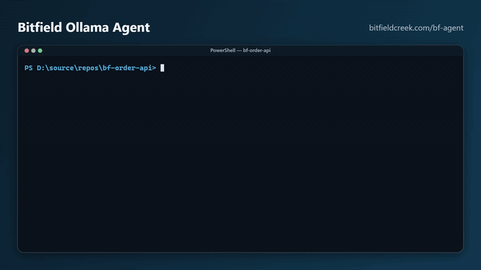

# Bitfield Ollama Agent (`bf-agent`)



### Pinned result

On 25 Oct 2026, bf-agent 1.1.25 scored **96 out of 100** on 34 graded tasks (69 minutes). Smaller tasks ran on local `qwen3-coder:30b`. Harder builds ran on `kimi-k2.7-code:cloud`. Windows, 32 cores, 64 GB RAM.

| What we asked | Tasks | Score | Result |
| --- | --- | --- | --- |
| Answer a question, edit one file, or add a small module | 8 | 99 | All passed |
| Fix a bug or add one behavior | 6 | 97 | All passed |
| Write a small command-line tool | 5 | 92 | All passed |
| Change a program that is already there | 5 | 97 | All passed |
| Build a larger tool from scratch | 10 | 94 | All passed |
| Do not change files you were only asked to read | 6 | — | 5 of 6 obeyed |

The miss: one read-only task also created `README.md` and `src/index.mjs` in its throwaway workspace. Scores above count only whether the requested work was done.

Local agent runtime that turns a completion API into a multi-step agent:
the model calls tools, observes results, and repeats until the task is done.
**Ollama is the default** (free, local). Optional peer SDKs can drive the same
loop (`openai`, `anthropic`), or nest GitHub Copilot under a supervising loop
(`--provider copilot`). The harness is modeled on Cursor's: a short system
prompt plus your rules files, a tool set the model uses to find its own
context, and a thin loop with hooks where callers add policy.

## Vision

A **free-to-nearly-free, super-flexible agent** — cost depends only on how you use it:

- On local Ollama models, running the agent costs nothing.
- Paired with **Aura Wire**, the same agent reaches routed, compressed, guarded
  traffic to any backend you choose — you pay only for what you route to paid providers.

Product shape:

| Principle | Meaning |
| --- | --- |
| **CLI + SDK** | Two first-class surfaces: a command line for humans and scripts, an SDK for embedding the loop in other software |
| **Compatible at every angle** | OpenAI-compatible API façade, standard tool schemas, MCP for external tools, any Ollama model — integrate with what already exists rather than inventing formats |
| **IDE integration via Wire** | Bitfield Ollama Agent ships no IDE extensions. Editors reach it through Aura Wire's `/v1` door and routing rules — Wire owns the IDE story |
| **Local-first, private** | Prompts, tools, and files stay on this machine unless you explicitly route elsewhere |

## Requirements

- Node.js 20+
- [Ollama](https://ollama.com) running locally (default `http://127.0.0.1:11434`) for the default provider
- The pinned local model, `ollama pull qwen3-coder:30b` (or the cloud pin, `ollama pull kimi-k2.7-code:cloud`, when there is no GPU)

**Zero runtime dependencies by default** — the Ollama path uses only Node built-ins.
Optional peer packages (`openai`, `@anthropic-ai/sdk`, `@github/copilot-sdk`) are
loaded only when you select those providers; `@bitfieldcreek/halo-scan` (itself
zero-dependency) is embedded automatically when installed — see
[Halo Scan code tools](#halo-scan-code-tools).

## Install

Published releases:

```powershell
npm install -g @bitfieldcreek/bf-agent
bf-agent models
bf-agent "what time is it right now?"
```

Try without installing:

```powershell
npx @bitfieldcreek/bf-agent "summarize README.md"
```

Or download the zip from [Bitfield Ollama Agent](https://www.bitfieldcreek.com/bf-agent) and use the `bin/` launchers below.

**Bitfield Ollama Agent** (`bf-agent`) is proprietary software — free for personal, non-commercial use. See [LICENSE](LICENSE) and the [Bitfield Creek EULA](https://www.bitfieldcreek.com/eula).

From a git checkout, use `node src/cli.mjs` or the launchers in `bin/`.

## Quick start

```powershell
node src/cli.mjs "what time is it right now?"
```

Or use the launchers in `bin/`, which check that Node.js 20+ is installed
(and print install instructions if not) before forwarding every argument to
the CLI:

```powershell
.\bin\bf-agent.ps1 "what time is it right now?"   # PowerShell
bin\bf-agent.cmd "what time is it right now?"      # cmd
./bin/bf-agent.sh "what time is it right now?"     # macOS / Linux
```

Options:

| Flag | Default | Meaning |
| --- | --- | --- |
| `--provider <name>` | `ollama` | `ollama` \| `openai` \| `anthropic` \| `copilot` — see [Providers](#providers) |
| `--model <name\|auto>` | `auto` | Model for the active provider; for `ollama`, `auto` picks the best installed model. For `copilot`, this is the Copilot worker model |
| `--api-key <key>` | env | API key for `openai` / `anthropic` (or `OPENAI_API_KEY` / `ANTHROPIC_API_KEY`) |
| `--supervisor-provider` | `ollama` | With `--provider copilot`: supervisor LLM (`ollama`\|`openai`\|`anthropic`) |
| `--supervisor-model` | `auto` | Supervisor model when nesting Copilot |
| `--base-url <url>` | `http://127.0.0.1:11434` | Ollama server (also OpenAI-compatible base URL for `openai`) |
| `--max-steps <n>` | `100` | Safety cap on model round-trips per turn (the model decides when it is done; this only stops runaways) |
| `--wall-clock <sec>` | off | Wall-clock budget for the run; the loop wraps up before the deadline instead of being killed |
| `--max-prompt-tokens <n>` | off | Cumulative prompt-token budget for the run (`400k` works). Steps cost 3k–20k tokens each, so this caps spend where `--max-steps` cannot; exceeded → plain-text wrap-up, exit code 2 |
| `--streak-nudge [n]` | off | After `n` (default 6) consecutive calls to one read-only tool, tell the model to answer or switch to a tool that answers in one call. Mutating tools (`write_file`, `edit_file`, `run_command`) never trigger it |
| `--no-completion-guard` | guard on | Do not challenge “done” on create/implement goals when no mutating tools (`write_file` / `edit_file` / `run_command`) ran. On by default (same idea as Copilot’s completion guard for the plain LLM path) |
| `--num-ctx <n\|auto>` | `auto` | Context window (tokens) sent to Ollama on every call — Ollama's own default is small and overflows silently. `auto` sizes it to the model and your memory (floor 16384, ceiling 65536); see `docs/context-spec.md` |
| `--cwd <path>` | current directory | Workspace root that file and shell tools are confined to |
| `--mode <ask\|agent>` | `ask` in a terminal, `agent` otherwise | `ask` confirms each write/shell call with a y/N prompt; `agent` runs unattended. Deletes and cleanup writes still need an explicit approval |
| `--auto-approve [policy]` | `off` | Approve gated tools without a prompt. Bare flag or `all`: every gated tool. `off`: none. Or a comma-separated list such as `write_file,run_command`. Those calls count as approved, including deletes. In ask mode, tools outside the list still prompt |
| `--no-auto-approve` | | Force auto-approve off (overrides config) |
| `--session <name>` | off | Persist and resume this conversation (`.bf/bf-agent/sessions/` in the workspace) |
| `--no-scan` | scan on | Do not embed [Halo Scan](#halo-scan-code-tools)'s structured code tools (embedded natively whenever `@bitfieldcreek/halo-scan` or a sibling `bf-chat-tools` checkout is present) |
| `--scan-profile <p>` | `auto` | Halo Scan tool packs: `auto` fingerprints the repo (base + up to two packs), `base`, `full`, or a pack name (`symbols`, `quality`, `web`, `config`) |
| `--index` | off | Build the local project vector index and register `search_project` (needs an Ollama embedding model) |
| `--mcp "<command>"` | none | Attach an MCP server over stdio (repeatable); tools are listed by name and fetched on demand |
| `--no-checkpoints` | off | Do not snapshot files before `write_file` / `edit_file` |
| `--quiet` | off | Suppress step trace; print only the final answer |
| `--think <mode>` | `auto` | Native model reasoning: `auto`, `true`, `false`/`off`, or `low`/`medium`/`high`/`max` |

The model is resolved against Ollama's installed list at startup. With
`auto` (the default), Bitfield Ollama Agent first takes the **pinned local model**
(`qwen3-coder:30b`, see `PINNED_MODELS` in `src/model-routing.mjs`) when it
is installed and fits in memory. Otherwise it picks the strongest installed
model that supports tool calling and is either thinking-capable or
coding-tuned, has at least 7B parameters, and fits comfortably in this
machine's memory — a model too weak to finish agent tasks wastes more than it
saves. When no local model qualifies, an installed
[Ollama cloud](https://ollama.com/cloud) model is used instead, the pinned
cloud model (`kimi-k2.7-code:cloud`) first: local-first, cloud only when we
must. Explicit `--model` names are always honored
(untagged names match their tags, so `llama3.2` finds `llama3.2:latest`)
with a warning when the choice looks too weak; missing names fall back to
auto-selection. Capabilities are asked of Ollama itself (`/api/show`), so
new models classify correctly; a family-name list is the fallback for older
Ollama versions. `bf-agent models` shows the classification and what
`auto` would pick.

**Why a pin.** The harness is tuned against one local line and one cloud
line so that bench history stays comparable and fixes target a known model's
quirks instead of the average of several. Those pins are `qwen3-coder:30b`
and `kimi-k2.7-code:cloud`. The 25 Oct 2026 result above is the current score
for them. The tier presets (`local`, `hybrid`, `cloud`, `cloud-max`) all use those two models; `cloud-max` is the cloud pin at maximum reasoning effort, not a different model. Local image turns still use `devstral-small-2`, because the local pin has no vision. The Cursor judge is separate: it grades from one prompt file and does not run an Ollama model. Recognized-benchmark runs default to the local pin at
`--num-ctx 24576` (the spec's recommendation for a non-thinking model; on a
24 GB GPU that costs ~16% decode speed versus a fully-resident 16k window and
saves a compaction every few steps). Change a pin deliberately, and start a
new scoreboard history when you do.

Sessions store the full transcript, an accumulated step log, and the list of
files the agent changed. Re-running with the same `--session` name continues
the conversation with prior context.

**Checkpoints:** before `write_file` or `edit_file` touches a file, its
pre-edit contents are copied under `.bf/bf-agent/checkpoints/<run-id>/` (first
snapshot per file per run). `bf-agent checkpoints list` shows runs;
`bf-agent checkpoints restore <run-id>` puts every file in that run back
(files the run created are deleted). Sessions record the run id.

## Providers

| Provider | Kind | Install (optional peer) | Notes |
| --- | --- | --- | --- |
| `ollama` (default) | Thin LLM | none | Auto model routing, embeddings, `--think` / `--num-ctx` |
| `openai` | Thin LLM | `npm install openai` | Requires `--model` and `OPENAI_API_KEY` |
| `anthropic` | Thin LLM | `npm install @anthropic-ai/sdk` | Requires `--model` and `ANTHROPIC_API_KEY` |
| `copilot` | Nested worker | `npm install @github/copilot-sdk` | Supervisor LLM (default Ollama) + `delegate_copilot` tool + completion-guard stop hook |

```powershell
bf-agent --provider openai --model gpt-5 "summarize this repo"
bf-agent --provider anthropic --model claude-sonnet-4-5 "list the public API"
bf-agent --provider copilot "fix the failing test"
bf-agent --provider copilot --supervisor-provider openai --supervisor-model gpt-5 "refactor auth"
```

**Copilot nested mode:** the outer loop is a supervisor with full context and
verify tools. Implementation work should go through `delegate_copilot`; when the
supervisor claims done without verifying, a stop hook challenges the claim.
Copilot owns its native tools during delegation — the supervisor should not
double-drive the same edits.

Paid / IDE multi-backend routing remains **Aura Wire's** job. These providers are
an optional local SDK path for CLI/SDK users. `bf-agent serve` stays Ollama-backed
for now.

## OpenAI-compatible server

```powershell
node src/cli.mjs serve --port 11435
```

Exposes the agent loop behind the standard OpenAI API so any existing client
(or Aura Wire routing rule) can use it with no Bitfield Ollama Agent awareness:

- `POST /v1/chat/completions` — messages in, agent loop (with tools) runs,
  `chat.completion` out. `stream: true` forwards content tokens live from
  Ollama as SSE chunks (falls back to replaying the finished answer when the
  backend has no `chatStream`). A `model` in the request overrides the default.
- `GET /v1/models` — installed Ollama models.

Serve mode always runs unattended (`agent` mode): there is no terminal to
prompt for approvals. `--auto-approve` still applies, so a listed tool counts
as approved (including deletes). Put Wire's guardrails in front if you need
policy.

## Docker Compose

Ollama + `bf-agent serve` (`/v1` on port 11435). The agent workspace is
`./workspace` → `/workspace`. Bench and test output use the sibling
`halo-agent-benchmark` folder → `/halo-agent-benchmark` (same tree as
`npm run bench` and `.\bin\bench-tb.ps1`). Copy `.env.example` to `.env` to
change model, ports, or those paths.

```powershell
docker compose up --build
docker compose --profile pull up ollama-pull
docker compose exec ollama ollama pull llama3.2
docker compose run --rm bf-agent models
docker compose run --rm bf-agent "what time is it right now?"
```

NVIDIA GPU for Ollama:

```powershell
docker compose -f docker-compose.yml -f docker-compose.gpu.yml up --build
```

Already running Ollama on the host (typical for Terminal-Bench / Harbor, which
reach it at `host.docker.internal:11434`):

```powershell
docker compose -f docker-compose.host-ollama.yml up --build
```

## SDK

The same machinery is embeddable — `createAgent()` wires up the client,
builtin tools, context-built system prompt, checkpoints, and compaction in
one call:

```js
import { createAgent } from "@bitfieldcreek/bf-agent";

const agent = await createAgent({
  model: "qwen3-coder:30b",
  workspaceRoot: "/path/to/project",
  tools: [{ name: "deploy", description: "Deploy the app.", execute: () => "done" }],
  haloScan: { profile: "auto" },          // default true; false keeps builtin file/search tools only
  maxPromptTokens: 400_000,               // cumulative budget per run; stopReason "token-budget" when hit
  streakNudge: true,                      // or a count; nudge after N calls in a row to one read-only tool
  completionGuard: true,                  // default: challenge hollow "done" on create/implement goals
  approvalHandler: async ({ name, args }) => confirmSomehow(name, args),
  hooks: {
    // Refuse a tool call; the reason goes back to the model as the result.
    beforeToolCall: ({ name, args }) =>
      name === "run_command" && /git push/.test(args.command) ? { block: "no pushes from CI" } : undefined,
    // Keep the turn going when the model stops too early (Cursor's stop hook).
    // Composed after the built-in hollow-completion guard when completionGuard is on.
    stop: ({ text, steps }) =>
      steps.some((s) => s.toolCalls.some((c) => c.name === "run_command")) ? undefined : { followupMessage: "Run the tests before finishing." },
  },
});

const run = agent.run("run the tests and fix any failure");
agent.steer("also check the lint output");   // delivered after the next tool results
agent.queue("then summarize what changed");  // runs as a new turn once this one ends
const { text, steps } = await run;
```

Hooks are the policy surface: `beforeToolCall` (block or observe),
`afterToolCall` (annotate a result), and `stop` (send a follow-up user
message, bounded by `maxStopHookLoops`). Verification, planning, and
"keep going until X" belong there and in rules files, not in the loop.

Every piece is also exported individually (`AgentLoop`, `ToolRegistry`,
`OllamaClient`, `createOpenAIServer`, `SessionStore`, `CheckpointStore`,
`McpClient`, ...) for setups that need different wiring. External MCP tools
bridge in via `registerMcpTools(agent.registry, await McpClient.connect({ command: "..." }))`.

## Builtin tools

| Tool | What it does |
| --- | --- |
| `read_file` | Read a file (optionally a line range) |
| `list_dir` | List a directory; subdirectory names end with `/` |
| `grep_search` | Regex search over file contents (`path:line: text`); prunes `node_modules`, `.git`, etc., skips binaries |
| `find_files` | Find files by glob (`*.mjs`, `src/**/*.js`) |
| `search_project` | Semantic search over the local project index (only with `--index` and an embedding model) |
| `fetch_rule` | Read a `.cursor/rules` rule the system prompt listed by name |
| `web_search` | Search the public web via DuckDuckGo (titles, URLs, snippets) |
| `fetch_url` | Fetch a page and return text; optional `query` runs micro-RAG for top passages |
| `write_file` | Create or overwrite a file, creating parent directories (checkpointed) |
| `edit_file` | Replace an exact snippet in a file (unique match or `replace_all`; checkpointed) |
| `run_command` | Run a shell command with captured output and a hard timeout |
| `describe_tool`, `call_mcp_tool` | Fetch an MCP tool's schema and invoke it (present when `--mcp` servers are attached) |
| `get_time`, `echo` | Diagnostics |

All file and shell tools are confined to the workspace root (`--cwd`): paths
that resolve outside it are rejected, and commands are killed (whole process
tree) after a timeout, 30s by default. Long tool output is never silently
truncated: past 32k characters the full text is written to
`.bf/bf-agent/tool-output/` and the model gets the head, the tail, and the
path, so it can `read_file` or `grep_search` the rest.

**Tool-name aliases.** Small models reach for names that do not exist —
`open_file`, `search`, `cat`, `ls`, `bash`. Those resolve at call time onto
the builtin they meant (with argument spellings such as `query` → `pattern`
and `line_start`/`line_end` → `offset`/`limit` rewritten), so the step is
not wasted on an "unknown tool" error. Aliases are never listed in the tool
schemas, so they cost no prompt tokens. The step trace prints `[alias]
open_file -> read_file` when one fires.

### Halo Scan code tools

[Halo Scan](https://www.npmjs.com/package/@bitfieldcreek/halo-scan)
(`@bitfieldcreek/halo-scan`, zero dependencies) is a read-only toolset for
navigating code by structure: `repo_overview`, `project_conventions`,
`entrypoint_map`, `file_outline`, `get_symbol`, `symbol_context`,
`find_references`, `changed_symbols`, `tests_for`, `git_history`, and more.
When it is installed (or a `bf-chat-tools` checkout sits next to this repo)
the agent embeds it **natively**: its tools are registered as ordinary
functions alongside the builtins, and its `read_file`, `list_dir`,
`grep_search`, and `find_files` replace the builtins under the same names
(they are supersets — batch `read_file paths:[...]`, `grep_search expand:
"symbol"`, hits tagged with the enclosing function). The "gather context"
bullet in the system prompt is swapped for one that points at the structured
tools first (`repo_overview`, `file_outline`, `symbol_context`, ...). Nothing
else changes: writes, shell, web, and rules are the builtins.

Why native rather than `--mcp "halo-scan"`: behind the lazy MCP bridge the
model sees only names and must spend `describe_tool` + `call_mcp_tool` to use
one, while `read_file` and `grep_search` are native functions it already
knows. Measured with Halo Scan's tool bench, 0.2 of 10.2 calls per question
reached Halo Scan through the bridge. Exposed natively the structured tools
replace grep → read → read loops with one call; see
[Dev bench](#dev-bench-agent--judge) for how to measure the effect on your
model.

`--scan-profile` controls the schema cost. `auto` (default) exposes the base
pack plus up to two packs chosen by fingerprinting the repo, and adds an
`activate_pack` tool so the model can pull in the rest on demand; `base`
is the smallest useful set; `full` exposes everything. The schemas are part
of every request, so on a 16k window prefer `base`. `--no-scan` (or
`scan: false` in `config.yaml`) keeps the builtin tool set only.

In the SDK the same switch is `createAgent({ haloScan: true | false | {
profile } })`; `agent.haloScan` reports what was embedded.

**Approvals:** in a terminal, `write_file`, `edit_file`, and `run_command`
each ask for y/N confirmation before running (`--mode ask`, the default).
Pass `--mode agent` to run unattended. Non-TTY and serve-mode runs are
always unattended.

**Deletions:** in unattended runs, file-deletion commands (`rm`, `del`,
`Remove-Item`, `git clean`, `find -delete`, …) only run when every deletion
target is explicitly named in the user's request. Deletes the user asked for
("delete junk-notes.txt") go ahead; conflicts and ambiguity are refused so
the agent asks instead — files the request says to keep, files it never
named (a bare "clean up"), wildcard-only targets, and indirect deletes
(`git clean`, piped `Remove-Item`). In `--mode ask` the y/N prompt decides,
as for any shell command.

## Context

Context follows Cursor's model: a small static block up front, everything
else discovered on demand with tools. The system prompt is built per run:

1. **Core instructions** — a short prompt about how to work (gather context
   with tools, read before editing, verify, keep going until done),
   communication, scope, and git/deletion safety. No task-type text lives
   here; that belongs in your rules files.
2. **Model overlay** — a few lines of family-specific guidance (e.g. for
   `gpt-oss`) when the model needs it.
3. **Instruction files** — user `instructions.md`, workspace `AGENTS.md` /
   `CLAUDE.md` / `.cursorrules`, and always-apply `.cursor/rules` inlined;
   described or file-scoped rules listed by name for `fetch_rule`; nested
   `AGENTS.md` files listed by path for `read_file`.
4. **Environment** — platform, shell, workspace root, current date, a git
   snapshot (branch + short status, like Cursor's `git_status` block), and
   the top-level directory listing.
5. **MCP tool index** — attached MCP tools by name and one-line description.

6. **Halo Scan guidance** — when Halo Scan is embedded, a few lines on
   navigating by structure (`repo_overview` to orient, `file_outline` /
   `get_symbol` instead of whole-file reads, `symbol_context` before
   changing a symbol).

The user's message is sent as written — no hints, plans, or wrappers are
added. README contents, project search results, and everything else come
in through the model's own tool calls, so the prompt stays small and the
model sees exactly what it asked for. The agent's own data directory
(`.bf/`) is hidden from the workspace listing and from `list_dir`.

Thinking-capable models get Ollama's native `think` mode enabled
automatically (`--think` to control). Long transcripts are compacted
automatically — older turns are summarized by the model while the system
message and recent turns are kept verbatim; the summary keeps the original
request word for word and, with `--session`, points at the transcript file
so dropped details can be re-read. Compaction triggers on real token usage:
every request carries an explicit `num_ctx`, and the loop watches the token
counts Ollama reports to compact before the window overflows.

The window itself is sized automatically (`--num-ctx auto`, the default):
the largest multiple of 4096 whose KV cache fits in the memory left after the
model's weights, between a 16384 floor and a 65536 ceiling (or the model's own
limit). The floor and the recommended minimums — 24k for a non-thinking model,
32k for a thinking one — are derived from measured prompt costs in
[`docs/context-spec.md`](docs/context-spec.md); a window under the spec for
its model is reported at startup as a `[context]` warning.

## Instruction files

Each run loads Cursor-style instruction files into the system prompt (after
the core instructions, before the environment snapshot). Missing files are
skipped. Inlined text is capped at 6000 characters per file and 12000
characters total.

**Apply order**

1. User `instructions.md` (if present)
2. Workspace root files, in this order: `AGENTS.md`, `CLAUDE.md`, `.cursorrules`
3. Always-apply rules from `.cursor/rules/` (`.mdc` or `.md`, sorted by name)
4. An index of the remaining rules (name, globs, description) the model can
   pull in with `fetch_rule`, and of nested `AGENTS.md` files (up to four
   directories deep, skipping `node_modules`, `.git`, build output) the model
   should `read_file` before working in that directory

**User instructions** — persistent personal rules, like Cursor user rules.
Create `instructions.md` in the agent config directory (same folder as
`config.yaml`):

| Platform | Default path |
| --- | --- |
| Windows | `%APPDATA%\halo-agent\instructions.md` |
| macOS / Linux | `~/.config/halo-agent/instructions.md` |

Override the directory with `HALO_AGENT_CONFIG_DIR`. `bf-agent config edit`
creates `config.yaml` there; `instructions.md` is optional and is not
created automatically.

**Workspace instructions** — project rules checked into the repo:

| File | When it applies |
| --- | --- |
| `AGENTS.md` | Always, if present at the workspace root (`--cwd`) |
| `CLAUDE.md` | Always, if present at the workspace root |
| `.cursorrules` | Always, if present at the workspace root |
| `.cursor/rules/*.mdc` or `*.md` | When the rule is always-apply (see below) |

Cursor `.mdc` frontmatter is honored:

```markdown
---
description: Core coding standards
alwaysApply: true
---

Match existing style. Do not add docs the user did not ask for.
```

| Frontmatter | Inlined? |
| --- | --- |
| `alwaysApply: true` | Yes |
| `alwaysApply: false` | No — listed for `fetch_rule` |
| `globs:` (and no `alwaysApply: true`) | No — listed with its globs for `fetch_rule` |
| `description:` only | No — listed with its description for `fetch_rule` (Cursor's "apply intelligently") |
| No frontmatter / no globs / no description | Yes |

Put cross-cutting project rules in `AGENTS.md` or an `alwaysApply: true`
`.mdc`. Give task-specific rules a `description` so the model can decide when
to fetch them; they cost nothing in the prompt until used.

## How the loop works

```
messages = [system, user goal]
repeat:
  response = model(messages, tools)
  if no tool calls:
      stop hook may send a follow-up user message and continue
      otherwise the turn is over (queued follow-ups start a new turn)
  execute each tool call (beforeToolCall may block, afterToolCall may annotate)
  append role=tool results
  deliver any steer() message the caller sent meanwhile
stop conditions: model stops calling tools, max steps / wall clock (with a
plain-text wrap-up), cancellation
```

The loop owns only transport robustness (retries on transient errors,
tool-call parse recovery), compaction, the step and wall-clock safety caps,
and the steer/queue channels. It does not plan, grade, nudge, or swap
models mid-run — the model does the work, rules files carry the task
knowledge, and hooks carry the caller's policy.

See `ROADMAP.md` for what is built and what is next.

## Release (maintainers)

Staging (R2 zip upload only — no npm):

```powershell
.\scripts\release\publish-release.ps1 -BumpPatch
```

Production (after [admin promote](https://www.bitfieldcreek.com/admin/releases)):

```powershell
.\scripts\commands\ha-release-npm.ps1
```

`ha-release-npm` verifies production `latest.yml` matches `package.json`, creates a GitHub release tagged `v<version>` with notes generated from commits since the previous release, then runs `npm publish`. Credentials: `scripts/release/.env.release` (`R2_*` for staging, `NPM_TOKEN` for production npm) and `gh` authenticated for the `package.json` repository.

## Tests

```powershell
node --test
```

Tests mock the Ollama client — no server or model required.

## Evals

```powershell
node evals/run.mjs --models llama3.2,qwen3-coder:30b
```

Runs real end-to-end tasks (answer from a README, create/edit files, find a
definition, run a command, fix a failing test) against live Ollama models in
throwaway temp workspaces, and reports pass rate, steps, and duration per
model. Use this to measure whether a runtime change actually improves agent
quality. `--task <name>` runs one task, `--json <file>` saves results,
`--verbose` traces tool calls. Exit code 2 means at least one task failed.

## Dev bench (agent + judge)

Host-only. No Harbor. Recommendations and scores come from this run.

```powershell
.\bin\bench-local.ps1
.\bin\bench-local.ps1 -SkipJudge
.\bin\bench-local.ps1 -Tier 2
.\bin\bench.ps1
npm run bench
node evals/dev-bench.mjs --tier 2
node evals/dev-bench.mjs --scenario greet-module --keep-workspace
```

Development benchmarks with **increasing complexity tiers** (simple module →
multi-file fixes → small CLI → HTTP API → refactor → log/CSV tools). Each
scenario runs Bitfield Ollama Agent in a fresh temp workspace, then grades the outcome with
the **Cursor CLI** (`agent --model auto`) in read-only ask mode.

**Config:** `bench.config.json` in the project root, or `evals/bench.config.json`
— loaded automatically when present. CLI flags override config values.
`npm run bench` picks it up with no extra flags.

**Tier progression** (on by default): runs tier 1, then tier 2, … with a
per-tier summary. Stops early if the tier average score falls below
`progression.stopBelowScore` (default 50). Use `--flat` to run all scenarios
without pausing between tiers.

When complete, prints an **assessment report** with overall score, per-tier
breakdown, per-scenario scores, and ranked judge recommendations. Reports
are also written to `../halo-agent-benchmark/local/latest.json` and
`latest.md` (configurable via `report` in `evals/bench.config.json`). Scenario
workspaces live under `../halo-agent-benchmark/<language>/…`; recognized
(Terminal-Bench) reports under `../halo-agent-benchmark/recognized/`.

### How a run is graded

Every scenario gets two scores, kept separate on purpose:

- **Outcome (0–100)** — did the deliverable satisfy the task. When the
  scenario has a mechanical oracle (the scenario `precheck`, or the Harbor
  hidden-test reward on Terminal-Bench), that result fixes the band: a pass
  lands in 70–100, a fail in 0–50, and the judge places the score within the
  band. The judge's own number is kept as `outcome.judgeScore`, and
  `agreesWithOracle` is recorded so a loose or flaky precheck shows up as a
  disagreement rather than as agent quality.
- **Process (0–100)** — how efficiently it got there. This is the
  "meta-judge" and it has two layers. `evals/efficiency.mjs` computes
  deterministic metrics straight from the trace (steps, tool calls by
  category, tokens, time, and waste flags such as `spinning`,
  `redundant-reads`, `blind-edit`, `no-verification`, `budget-exhausted`).
  Those numbers go into the judge prompt as evidence, and the Cursor judge
  adds the qualitative read — detours, disproportionate exploration, steps it
  considers wasted — as `process.score`, `process.notes`, and
  `process.wastedSteps`. The deterministic `heuristicScore` is a comparison
  aid across runs, not a grade.

The judge sees the task, the agent's final answer, a step summary, the
efficiency block, and the **change set**: a unified diff of every file the
agent touched, built from the run's checkpoints (`.bf/bf-agent/checkpoints/`)
paired with the final workspace. Files changed only through shell commands
are not checkpointed, so a paths-and-sizes listing of the workspace is
included as a fallback, and Harbor trials with no collected `/app` artifact
fall back to the trial directory. The judge input (artifacts JSON, step
summary, full prompt) is written to `.halo-bench/` inside the scenario
workspace, so `--keep-workspace` leaves everything needed to re-derive a
verdict.

The scoreboard (`../halo-agent-benchmark/local/scoreboard-history.jsonl`) records `avgScore`,
`avgProcessScore`, `passRate`, `avgSteps`, `avgToolCalls`,
`avgPromptTokens`, `verifiedRate`, `avgHeuristicScore`, and `flagCounts` per
run, so a prompt or tool change can be judged on cost as well as correctness.

To re-analyze a report or the scoreboard history alone:

```bash
npm run bench:patterns -- --report ../halo-agent-benchmark/local/latest.json
npm run bench:patterns -- --scoreboard ../halo-agent-benchmark/local/scoreboard-history.jsonl
```

| Flag | Meaning |
| --- | --- |
| `--config <path>` | Config file (default: `bench.config.json` or `evals/bench.config.json` if present) |
| `--tier <n>` | Run scenarios up to tier *n* |
| `--progression` / `--flat` | Enable or disable tier-by-tier progression |
| `--stop-below <score>` | Halt progression when tier average is below *score* |
| `--scenario <name>` | Run one scenario |
| `--scenarios a,b,c` | Run a subset |
| `--model <name\|auto>` | Ollama model for Bitfield Ollama Agent |
| `--skip-judge` | Run agent only (no Cursor CLI) |
| `--judge-model auto` | Judge model (default `auto`) |
| `--keep-workspace` | Leave temp dir for inspection |
| `--json` / `--markdown` | Report output paths |
| `--no-report` | Skip writing report files |

Requires Ollama for the agent and the Cursor CLI (`agent`) for judging. Not a
release gate — run while iterating on the runtime.

## Recognized benchmarks (on demand)

Public leaderboard suites, **separate from the local development bench**.
Harbor runs each Terminal-Bench task in Docker; that is why this launcher
uses Docker. For scores and recommendations without Harbor, use
`.\bin\bench-local.ps1`.

```powershell
.\bin\bench-tb.ps1
.\bin\bench-tb.ps1 -Check
.\bin\bench-tb.ps1 -SkipJudge
.\bin\bench-tb.ps1 -Include openssl-selfsigned-cert
.\bin\bench-tb-mini.ps1
.\bin\bench-tb-mini.ps1 -Count 5 -Seed 42
.\bin\bench-tb.ps1 -FromJob path\to\harbor\job
.\bin\bench-tb.ps1 -Compose
npm run bench:tb:mini
npm run bench:recognized -- --list
```

`bench-tb-mini` shuffles the Terminal-Bench 2.1 catalog and runs **5** tasks (override with `-Count`). That is not Harbor `--n-tasks`, which takes the first N after filters. The chosen names and RNG seed are printed (`sample: … (seed N)`); pass `-Seed` / `--seed` to repeat the same draw. `--include` still works: the sample is drawn from that list instead of the full catalog.

`--skip-judge` records only Harbor pass/fail. Default is to judge every trial.

Needs Docker, [Harbor](https://harborframework.com/) (`uv tool install harbor`),
Ollama reachable from containers (`host.docker.internal`), and the Cursor CLI
unless you skip the judge. Reports (JSON + markdown) go to
`../halo-agent-benchmark/recognized/<suite>/<run-id>/` plus `latest.json` /
`latest.md`.

SWE-bench Verified is listed as planned (`--list`); it is not wired yet.

## Layout

| Path | Purpose |
| --- | --- |
| `src/agent-loop.mjs` | Thin Cursor-style loop: model -> tools -> repeat, with hooks, steer/queue, retries, safety caps |
| `src/ollama-client.mjs` | Thin `/api/chat` client (default provider) |
| `src/provider-client.mjs` | Shared `ProviderClientError` + peer SDK import helper |
| `src/providers/factory.mjs` | `createProviderClient` (`ollama` / `openai` / `anthropic` / `copilot`) |
| `src/providers/openai-client.mjs` | Optional `openai` peer adapter |
| `src/providers/anthropic-client.mjs` | Optional `@anthropic-ai/sdk` peer adapter |
| `src/providers/copilot-worker.mjs` | Nested `delegate_copilot` + completion guard |
| `src/hollow-completion-guard.mjs` | Default stop hook: challenge hollow “done” on create/implement goals with no mutating tools |
| `src/providers/message-bridge.mjs` | Loop transcript ↔ OpenAI / Anthropic wire formats |
| `src/tool-registry.mjs` | Tool schema + executor dispatch, approval gating, call-time name aliases |
| `src/tools/halo-scan.mjs` | Embeds `@bitfieldcreek/halo-scan` natively: optional import, builtin replacement, pack activation, output spill |
| `src/context-builder.mjs` | System prompt: instruction files, rule index, git snapshot, environment |
| `src/compaction.mjs` | Summarizes old turns when the transcript outgrows its budget |
| `src/checkpoints.mjs` | Pre-edit file snapshots under `.bf/bf-agent/checkpoints/` with list/restore |
| `src/model-tuning.mjs` | Per-model-family settings: think mode, prompt overlay |
| `src/openai-server.mjs` | `/v1/chat/completions` facade over the loop |
| `src/session-store.mjs` | Persist/resume sessions with step log and changed files |
| `src/model-routing.mjs` | Tool-capable detection and installed-model resolution |
| `src/mcp-client.mjs` | Stdio MCP client + lazy registry bridge (`describe_tool` / `call_mcp_tool`) |
| `src/index.mjs` | SDK entry point (`createAgent` and all public exports) |
| `src/tools/builtin.mjs` | Registers the standard tool set (diagnostics + file + search + rules + shell) |
| `src/tools/fs.mjs` | Workspace-scoped file tools and path guards |
| `src/tools/output.mjs` | Spills long tool output to `.bf/bf-agent/tool-output/` (head + tail + path) |
| `src/tools/search.mjs` | `grep_search` and `find_files` over the workspace tree |
| `src/tools/web-search.mjs` | `web_search` via DuckDuckGo HTML results |
| `src/tools/fetch-url.mjs` | `fetch_url` with HTML extract + micro-RAG |
| `src/tools/shell.mjs` | `run_command` with tree-kill timeout |
| `src/cli.mjs` | Command-line entry point |
| `Dockerfile` | Image for `bf-agent serve` (and one-shot CLI via `compose run`) |
| `docker-compose.yml` | Ollama + Bitfield Ollama Agent; see `docker-compose.gpu.yml` and `docker-compose.host-ollama.yml` |
| `evals/` | Live-model eval harness (`evals/run.mjs`), dev bench (`evals/dev-bench.mjs`), recognized benches (`evals/recognized/`) |

## Relationship to Aura Wire

Bitfield Ollama Agent is a standalone product, but **Wire is the pairing that completes it**:
Wire provides the OpenAI `/v1` front door, routing rules, cost observability,
compression, and guardrails; Bitfield Ollama Agent provides the loop and local tool execution.
IDE integration is deliberately Wire's job — editors point at Wire, and Wire
routes to Bitfield Ollama Agent as a custom provider via `bf-agent serve` (the
OpenAI-compatible door, roadmap item 10). Composition is HTTP only, no shared
code. Details from the Aura Wire side: `aura-wire/docs/halo-agent-integration.md`.
